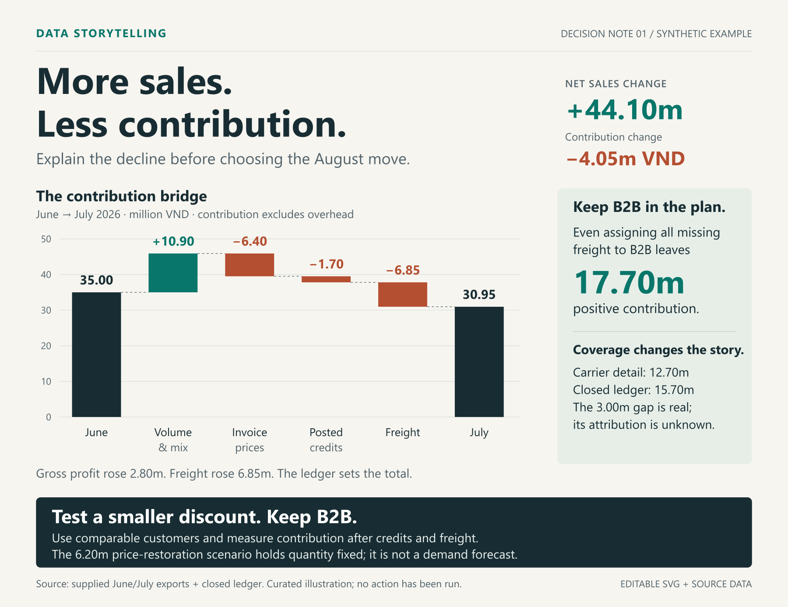
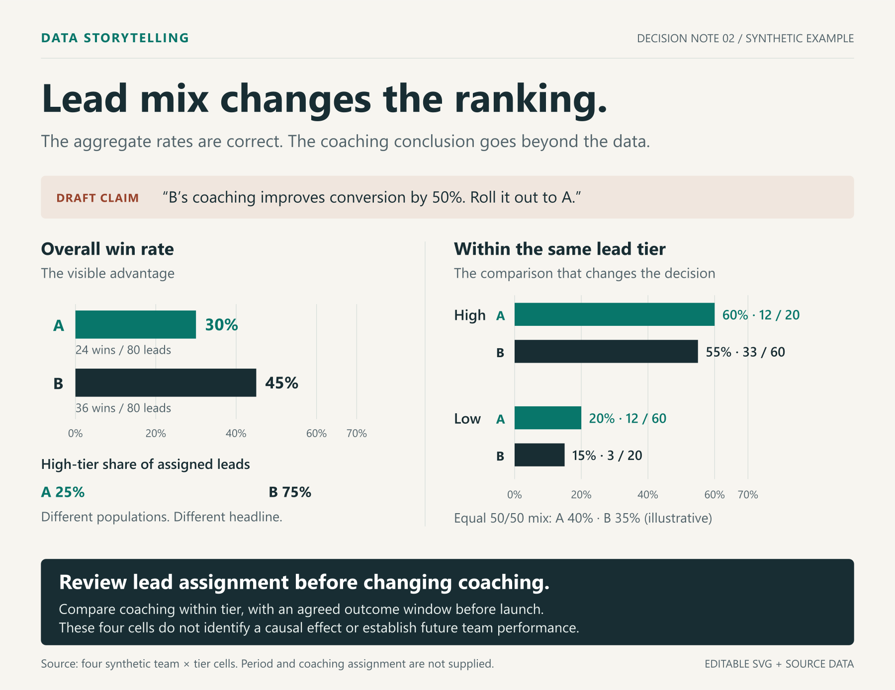
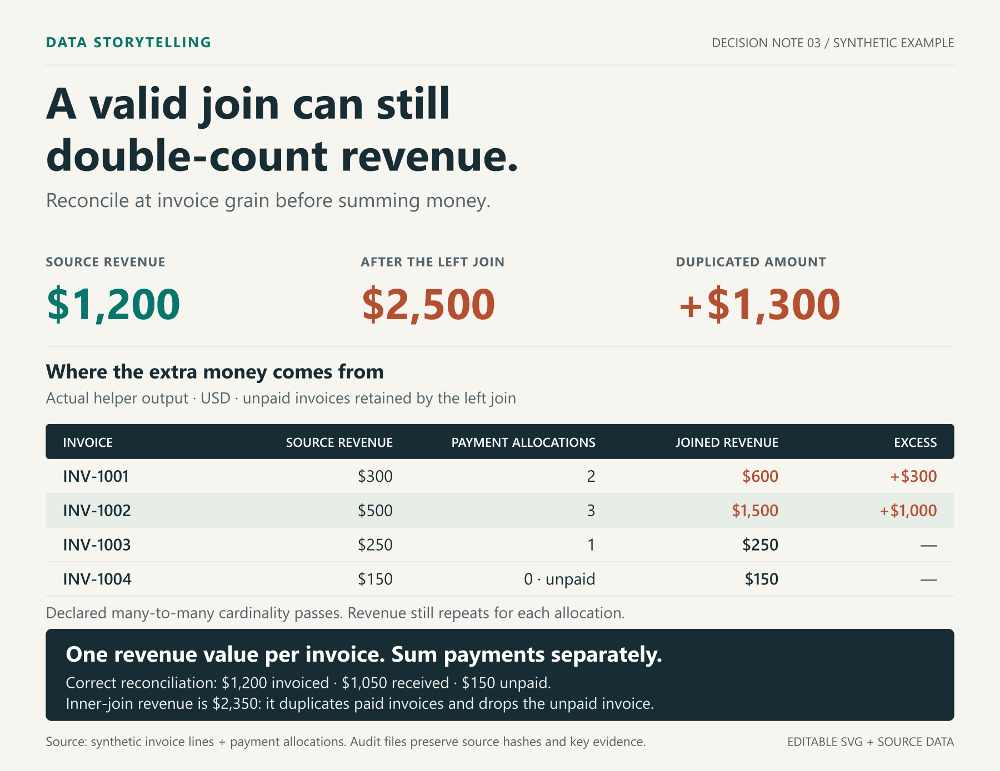

# Data Storytelling Skills

Turn business data into a decision someone can understand, challenge and act on. Six complementary Codex skills cover diagnosis, narrative, charts, evidence repair and a practical measurement plan. English instructions support Vietnamese and English requests.

## See the work

### 01 — More sales. Less contribution.

Sales rise **VND44.10m**, while contribution falls **VND4.05m**. A reconciled bridge explains the change; a conservative B2B bound supports a limited price test with demand guardrails.



[Copy the request](examples/01-profit-decision/brief.md) · [Read the memo](examples/01-profit-decision/memo.md) · [Inspect the test plan](examples/01-profit-decision/test-plan.md) · [Source, calculations and editable SVG](examples/01-profit-decision/README.md)

### 02 — Lead mix changes the ranking.

The report's headline rates are correct. Its coaching conclusion is unsupported. The repaired comparison keeps the aggregate rates, shows every denominator and reveals the different lead populations.



[Request, repaired decision and source data](examples/02-fair-comparison/README.md) · [Editable SVG](examples/02-fair-comparison/comparison.svg)

### 03 — Revenue did not double. The join repeated it.

**$1,200** of invoiced revenue becomes **$2,500** after a raw join. The executed audit locates **$1,300** of duplication; the corrected reconciliation keeps the unpaid invoice visible.



[Try the request and reproduce the audit](examples/03-join-audit/README.md) · [Actual tool output](examples/03-join-audit/result/report.json) · [Editable SVG](examples/03-join-audit/join.svg)

These are synthetic, curated worked examples with checked calculations and inspected exports. No customer result, intervention outcome or general advantage over an unassisted model is claimed. [Browse the gallery and rebuild the files](examples/README.md).

## Choose the job

| Skill | Job |
|---|---|
| `data-storytelling` | Select and combine the work needed for a multi-output request |
| `business-insight-diagnosis` | Explain changes, prioritize findings and choose a supported action/test |
| `evidence-to-narrative` | Write a reader-ready memo, email draft or slide argument |
| `business-chart-communication` | Produce or repair an editable communication chart |
| `data-story-redteam` | Challenge and repair misleading claims, charts and recommendations |
| `analytics-adoption` | Plan recurring metric stewardship, decisions and outcome learning |

## Give a normal request

> Từ dữ liệu này, giải thích biến động, chọn việc nên làm, tạo biểu đồ và viết memo ngắn cho giám đốc. Kiểm lại số liệu và giữ rõ các giới hạn kết luận.

> Repair this chart and the conclusion it supports. Preserve the source data, show relevant denominators, and deliver an editable chart plus a concise explanation.

The assistant can select several complementary methods for one prompt. Direct invocation such as `$data-storytelling` or `$business-chart-communication` is also available. Descriptions and instructions support discovery; they are not an autonomous scheduler or a guarantee that every client will select correctly.

## Install

Copy the six folders under `skills/` into your client's discoverable skill directory (commonly `~/.codex/skills`). Each folder carries the references it needs. Automatic invocation is enabled.

Optional standard-library installer:

```text
python tools/install.py --dest ~/.codex/skills
python tools/install.py --dest ~/.codex/skills --apply --replace --backup-dir ./private-backups
```

The first command previews. Applying replacements requires a backup directory; existing resources not listed in this package are retained. No dependency download, server, credential or MCP setup is required. Use an available Python runtime appropriate to your machine. Refresh the client's skill metadata or start a fresh chat if its catalog is stale.

## Complement the existing stack

Use available statistical analysis for inference, economics for unit/capacity/scenario calculations, scientific visualization for figure mechanics, native Office/PDF methods for actual formats and verification methods for final numeric handoffs. Those methods are referenced, not bundled or required to be installed under a particular brand. The suite does not create tools, accounts, permissions or free API credits.

Canonical shared references live under `shared/`; `tools/sync_shared.py` copies them into the independently installable folders. Run `python tools/validate.py` after edits. Structural validation does not establish output quality.

For raw CSV analysis, business-insight-diagnosis includes a standard-library [join audit](skills/business-insight-diagnosis/references/join-audit.md). It checks a declared key relationship, predicts join row counts and repeated additive amounts, and saves source hashes and key-level evidence without materializing the expanded join. It preserves exact keys and decimal amounts and rejects malformed inputs. It does not infer the right business key, source authority or eligible population; those remain analytical decisions. The helper is optional for tasks that need it.

`tools/test_join_audit.py` checks the helper against independently materialized joins and separate exact arithmetic. Pass the helper's path and `--workdir` pointing to a new temporary directory. The recorded local run passed 13 test groups, including malformed inputs, composite keys, signed cancellation and precision beyond 28 digits; this validates those behaviors, not the quality of a business recommendation.

## Source and evaluation

This independently authored suite operationalizes useful ideas from an 89-page MDA ebook using original wording and corrected scopes. It is not an MDA or OpenAI product. [Method coverage](shared/source-method-map.md) records every source range and the treatment of advertising, unverified cases and rigid heuristics. The private original remains outside this repository. [Attribution](NOTICE.md) explains MIT's scope.

Evaluation uses synthetic inputs, normal-language requests, direct calculation checks, rendered artifacts and observed method selection. See `evals/README.md` for the protocol and recorded results. These pilots do not establish universal professional quality, causal business improvement or guaranteed routing. No production customer data or external commercial actions are used.

The pilot passed five subcases in both baseline and candidate conditions, plus two separate narrow controls. Later comparisons produced quality ties; two raw-data candidate sessions saved the files but missed the 600-second completion limit while baseline completed. The suite has no demonstrated overall quality, speed or completion advantage. [Recorded results and limits](evals/README.md).

## Current improvements

- Evidence-ready readouts preserve actual deadlines and wait for complete outcomes.
- Measurement corrections are separated from like-for-like business change.
- Recommendations show the strongest feasible alternative and evidenced opportunity cost.
- Diagnosis/narrative references are loaded when an unresolved method question needs them.
- The optional CSV join audit uses exact amounts and records key-level duplication evidence. Independent black-box checks passed 13 groups; the gallery also executes it on a practical invoice/payment example.

The latest specialist versions are 2.2.1 for diagnosis/narrative, 2.1.1 for adoption and 2.1.0 for the other three. Tested utility behavior and polished worked examples support their stated scopes; neither substitutes for comparative or real-world outcome evidence.

## License

[MIT](LICENSE) for this project's original instructions, tools and synthetic examples. The source PDF and complementary third-party skills are not relicensed or redistributed.
