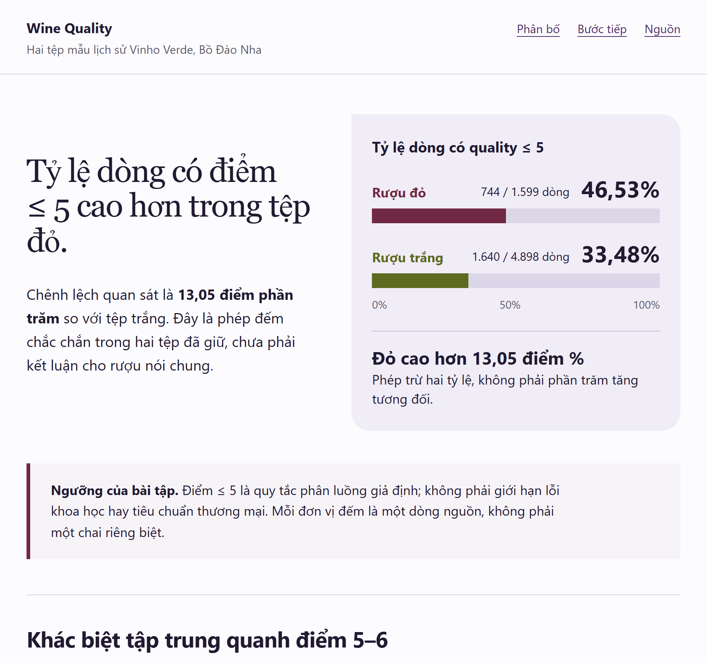
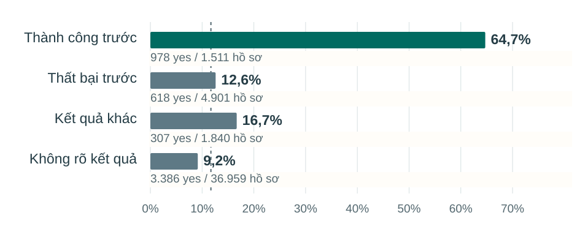

# Data Storytelling Skills · 3.5.0

Turn business data into a choice someone can understand, check and act on. Six complementary Codex skills cover diagnosis, narrative, charts, evidence repair and recurring measurement. English instructions support Vietnamese and English requests.

The 3.5 revision connects substantial HTML work with actual Frontend and art-direction methods when available, keeps one clear primary comparison with accessible supporting detail, and checks narrow-screen lookup, captions and operating rules. It retains source/quantity safeguards: requested counts must remain visible, time gaps keep their real spacing and joined-record counts cannot silently become distinct-entity counts. [Exact optional visual complements](optional-complements/README.md) make that composite activation inspectable and reproducible without overwriting an existing design stack.

**Current result is mixed.** In the fresh Wine trial, the composite is preferred for polish over 3.3 and Frontend, and ties the two other rivals after swapped-position disagreement. Readability/usability ties all four. Its two readers answer 8/8 questions correctly and preserve 80/80 raw values; 1/2 completes every strict recipient check because the other omits an explicit action-HOLD field. [Failures, raw votes and usable originals](evals/forward-v3.5.md) remain visible; this is not an all-gates pass or production certification.

The [3.4 forward record](evals/forward-v3.4.md) preserves the failed polish target and unchanged official VisEval scores: 21/29 fully passing tasks for the candidate, published 3.3 and Frontend. A separate source-correct handoff or successful build does not cancel a visual failure. The later focused 3.4.1 quantity repair remains a two-case follow-up, not a full benchmark rerun.

The 3.3 revision repaired document-level SVG naming, long table values and sum/value versus row-count meaning. [Its untouched-output solo trial](evals/solo-v3.3.md) remains separate from later tests and curated examples.

The 3.2 revision introduced practical display-size checks, text/vector sources and separate browser/PDF inspection. [Primary repository methods](shared/repository-methods.md) and [its unfamiliar-source trial](evals/visual-v3.2.md) state what was actually examined and run.

The earlier 3.1.2 revision repairs errors found in unchanged native files and unfamiliar-data executions: claim scope and comparisons, category integrity, chart hierarchy and color meaning, visible qualifications, verified launch prerequisites and resource availability, and executable rebuild instructions. [Forward-test procedure, failed trials and method changes](evals/forward-v3.1.md) are recorded separately from the curated gallery.

The 3.0 revision follows a complete reread of the supplied 89-page MDA guide. It changes the actual methods: decision-relevant contrasts, evidence sequencing, reader/grain/channel choices, visible qualifications, chart composition and practical action handoffs. [See the source-to-execution map](shared/source-method-map.md).

## See the work

### New — Read the difference, keep the limits, prepare the next record

A fresh execution of the frozen 3.5 composite uses UCI Wine Quality, a source absent from the earlier trials. It distinguishes the higher share of scores ≤5 in the red file from the larger number of such rows in the white file. The complete ordinal distribution and source-row limits stay close to the explanation; the next step is a conditional desktop provenance check with a usable form and 40-row HOLD worklist.



[Download the complete offline package](https://github.com/builtbyhuy/data-storytelling-skills/raw/refs/heads/main/evals/practical-v3.5/N91-untouched-practical.zip) · [Original form source](examples/08-wine-quality/work-form.html) · [Original source and portable recipe](examples/08-wine-quality/README.md) · [All five complete untouched handoffs](evals/practical-v3.5/README.md) · [Separate source, reader, handoff and visual results](evals/forward-v3.5.md)

Extract the package and open `report.html`; its form, sources and CSVs then resolve locally.

**Owner output/rebuild-code edits: 0.** All 16 published author files match the first completed recovery handoff, including the original README, template, form and source ZIP. Five declared outputs rebuild byte for byte using standard-library Python. Native HTML/text/CSS bars remain sharp at the reading size; the PNG is only an unchanged browser preview. A disclosed exact table still needs horizontal panning on phones. The [package note](examples/08-wine-quality/PACKAGE.md) and evaluation retain that friction, interrupted-batch recovery, capture repair and model-review limits. This is a practical forward test, not a new official benchmark score or proof of human preference.

### A diagnostic before the next contact campaign

An untouched solo execution turns UCI's original Bank Marketing file into a four-page Vietnamese report. It separates the strong historical association with prior campaign success from the limits of observed contact counts, then proposes a conditional 60-record process audit. The 45,211 source records do not establish unique customers or the effect of prioritising a future list.



[Download the offline responsive HTML](https://github.com/builtbyhuy/data-storytelling-skills/raw/refs/heads/main/examples/06-bank-marketing/report.html) · [Four-page searchable/vector PDF](examples/06-bank-marketing/report.pdf) · [Four original SVGs](examples/06-bank-marketing/charts/) · [Original author README and recipe](examples/06-bank-marketing/README.md) · [Source credit, exact-file manifest and packaging limits](examples/06-bank-marketing/PACKAGE.md)

**Owner output/rebuild-code edits: 0.** All 22 copied author files match the first completed handoff seal, including the original README. Independent numeric, browser/PDF and relocated-rebuild checks passed within the scopes recorded in [PUBLICATION.json](examples/06-bank-marketing/PUBLICATION.json). Both sealed anonymous model readers returned GO. The [four-method comparison](evals/solo-v3.3.md) retains ties and disagreements: this suite is preferred for clarity/taste over K-Dense, ties the additional MIT Visual Explainer on taste, and has no universal or overall winner claim. Human response and business execution remain unmeasured.

### An editorial angle with its counterevidence

An unfamiliar Ember dataset becomes a four-page Vietnamese editorial report. Vietnam's wind+solar generation share rose most among the five selected countries over 2015–2024, yet its 2024 share fell while generation grew. The report explains the denominator and proposes a two-day source check; it does not claim a policy effect or an all-ASEAN ranking.


[Download the offline responsive HTML](https://github.com/builtbyhuy/data-storytelling-skills/raw/refs/heads/main/examples/05-asean-electricity/energy-editorial.vi.html) · [Four-page vector PDF](examples/05-asean-electricity/energy-editorial.vi.pdf) · [Editable SVGs](examples/05-asean-electricity/charts/) · [Frozen source, original recipe and exact-file manifest](examples/05-asean-electricity/README.md)


The HTML changes chart composition on phones and keeps text/vector content; PNG previews are secondary. **Owner output/rebuild-code edits: 0.** The completed handoff was sealed before owner artifact review. Independent source, format, actual-size/reader and relocated rebuild checks are separate from author selfchecks; [their final scope and limits](examples/05-asean-electricity/PUBLICATION.json) include the still-unmeasured human response and original chat-preview surface.

<details>
<summary>Earlier untouched real-data execution — 3.1.2</summary>

### Attendance support:  investigate first, launch conditionally

A fresh 3.1.2 execution used unfamiliar real DfE data for all 153 England authorities, two school phases and two autumn terms. The untouched handoff proposes investigating three places and opening one team only after verified local prerequisites. Its source statistics do not establish eligible families or programme impact; the service scenario is fictional.


[Native PowerPoint](examples/04-attendance-pilot/thu-nghiem-chuyen-can.pptx) · [Same-deck PDF](examples/04-attendance-pilot/thu-nghiem-chuyen-can.pdf) · [Formula workbook](examples/04-attendance-pilot/tong-hop-chuyen-can.xlsx) · [Brief, original recipe, source and hashes](examples/04-attendance-pilot/README.md)


All five pre-registered gates passed within scope: independent source/reasoning, actual native formats, visual communication, model-reader comprehension and practical handoff. The first final files were sealed before review; **the owner changed no output or rebuild code**. Actual PowerPoint exports match all nine delivered pages, actual Excel recalculation matches 8,684 cells and 2,805 formulas, and the exact relocated recipe reproduces those pages and workbook data. Ordinary chart Edit Data UI/cache refresh and human taste remain unverified. [Two failed trials, repairs and this pass](evals/forward-v3.1.md).

</details>

<details>
<summary>Earlier curated synthetic examples — 3.0</summary>

### 01 — Doanh thu tăng, đóng góp giảm: nên đổi gì?

A meeting memo reconciles the change, exposes unallocated freight and proposes a bounded delivery test. Its workbook, plan and populated decision record separate checked facts from an unexecuted proposal.


[Open the one-page PDF](examples/01-profit-decision/brief.pdf) · [Editable SVG](examples/01-profit-decision/brief.svg) · [Workbook](examples/01-profit-decision/analysis.xlsx) · [Request, source, plan and rebuild](examples/01-profit-decision/README.md)

### 02 — “Tăng 50%” chưa chứng minh coaching có hiệu quả

The corrected report preserves the true overall rates, shows the different lead populations and keeps the causal limit beside the conclusion. The proposed next decision follows from that evidence.


[Open the one-page PDF](examples/02-fair-comparison/brief.pdf) · [Editable SVG](examples/02-fair-comparison/brief.svg) · [Ready-to-use repaired claim](examples/02-fair-comparison/memo.md) · [Request and source](examples/02-fair-comparison/README.md)

### 03 — Tiền bị tính lặp ở đâu khi ghép bảng?

A six-cell invoice example shows the repetition. The accounting table retains all four invoices, separates billed revenue from cash and preserves the unpaid balance. The executed audit is checked against literal joins.


[Open the one-page PDF](examples/03-join-audit/brief.pdf) · [Editable SVG](examples/03-join-audit/brief.svg) · [Accounting CSV](examples/03-join-audit/invoice-reconciliation.csv) · [Request, audit and rebuild](examples/03-join-audit/README.md)

These synthetic examples began as fresh independent executions of the revised skills using raw inputs and realistic briefs, without old outputs or intended answers. The published copies incorporate reader-review and portability edits. They are curated handoffs, not untouched trials, customer outcomes or aesthetic certification. [Gallery and use instructions](examples/README.md) · [3.0 checks and limits](evals/book-aligned-v3.md).

</details>

## Choose the job

| Skill | Job |
|---|---|
| `data-storytelling` | Select and combine the work needed for a multi-output request |
| `business-insight-diagnosis` | Explain changes, prioritize findings and choose a supported action/test |
| `evidence-to-narrative` | Write a reader-ready memo, email draft or slide argument |
| `business-chart-communication` | Produce or repair an editable communication chart |
| `data-story-redteam` | Challenge and repair misleading claims, charts and recommendations |
| `analytics-adoption` | Plan recurring metric stewardship, decisions and outcome learning |

All six core skills are version 3.5.0. A narrow KPI question stays short; a decision memo does not require all six methods.

## Give a normal request

> Từ dữ liệu này, giải thích biến động, chọn việc nên làm, tạo biểu đồ và viết memo ngắn cho giám đốc. Kiểm số liệu và giữ rõ các giới hạn kết luận.

> Repair this chart and its conclusion. Preserve the source, show relevant denominators, and deliver an editable chart plus a concise decision-ready explanation.

The assistant can select complementary methods for one prompt. Direct invocation such as `$data-storytelling` is also available. Descriptions support discovery; they are not an autonomous scheduler or a guarantee that every client selects correctly.

## Install

Copy the six folders under `skills/` into your client's discoverable skill directory, commonly `~/.codex/skills`. Each folder includes its references. Automatic invocation is enabled.

```text
python tools/install.py --dest ~/.codex/skills
python tools/install.py --dest ~/.codex/skills --apply --replace --backup-dir ./private-backups
```

The first command previews. Replacement requires a backup directory and preserves unlisted existing resources. The skill package and optional CSV audit require no dependency download, server, credential or MCP setup. Use an available Python runtime. Refresh stale client metadata or start a fresh chat when needed. Example PDF/workbook rebuilding has separate optional local rendering dependencies; viewing the delivered files needs no rebuild.

## Complement the existing stack

Use available statistical methods for inference, economics for cost/capacity/scenarios, figure tools for demanding charts, native Office/PDF methods for actual formats and verification methods for numeric handoffs. Most capabilities are referenced, not bundled or required under a particular brand. The [optional visual snapshot](optional-complements/README.md) separately retains the two methods used by the 3.5 composite condition, with their license and environment qualifications; the core installer still installs only the six suite folders. The standalone fallback remains usable but is not a separate measured 3.5 Wine condition. The optional helpers are local code; skills grant no account access or execution permission.

Canonical shared references live under `shared/`; `python tools/sync_shared.py` updates independently installable copies. `python tools/validate.py` checks package structure, links, source boundaries and copies. These checks do not establish output quality.

The optional [CSV join audit](skills/business-insight-diagnosis/references/join-audit.md) predicts row multiplication and repeated additive amounts with exact keys/decimals, source hashes and key-level evidence. It does not infer source authority, business key or eligible population. [Independent black-box tests](tools/test_join_audit.py) previously passed 13 groups / 48 invocations; the new invoice example also runs the unchanged helper against materialized joins.

The optional [Office handoff checker](skills/data-story-redteam/scripts/check_office_handoff.py) inspects native PPTX category/data caches, notes and XLSX formula caches using the Python standard library. [Six parser controls](tools/test_office_handoff.py) cover its checked failure modes. It reports unresolved bindings and unsupported chart types as unverified; a structural pass does not certify the values, appearance or readability of a presentation.

The optional [browser exporter](skills/business-chart-communication/references/browser-export.md) requires an existing Node, Playwright and Chromium capability. It exports authored local HTML and measures marked essential text at actual display widths. [Ten independent regression controls](tools/test_browser_export.mjs) cover real failures found during development; these gates do not certify every overlap, data claim or human reading outcome. No browser/library download is part of skill installation.

## Source and evidence

This independently authored suite adapts useful ideas from the user's MDA guide using original wording and qualified scopes. It is not an MDA or OpenAI product. [Coverage and operational qualifications](shared/source-method-map.md) include source advertising, unverified business cases and rigid heuristics. The original ebook and page images remain private. Only newly authored example PDFs are distributed. [Attribution](NOTICE.md).

The 3.0 checks cover actual artifacts, source calculations, narrow controls and model reader inspection. No human comprehension, accepted taste, beneficial adoption or real intervention outcome has been measured. The profit workbook's cached values and formula presence were checked; an Excel recalculation engine was not run.

Earlier evaluations remain in [the historical record](evals/README.md): quality ties, candidate completion-limit failures and negative polish comparisons are retained. The suite has no demonstrated overall quality, speed or completion advantage over an unassisted model. Matched activations on a shared model/catalog do not establish an isolated causal effect; no human taste or business-outcome advantage is claimed.

## License

[MIT](LICENSE) covers this project's original instructions, tools and synthetic examples. The source ebook is not redistributed. Optional Frontend Design retains its included Apache-2.0 license; original artifact-art-direction instructions retain project MIT scope. Other complementary methods are referenced rather than bundled.

MIT also covers the project's original code, explanation and layout in the real-data examples. DfE information retains OGL v3.0; Ember and UCI data/source information retain CC BY 4.0. [Attribution and scope](NOTICE.md) distinguish the data from original work. Publisher logos, website assets, original source PDFs and private account evidence are excluded.
