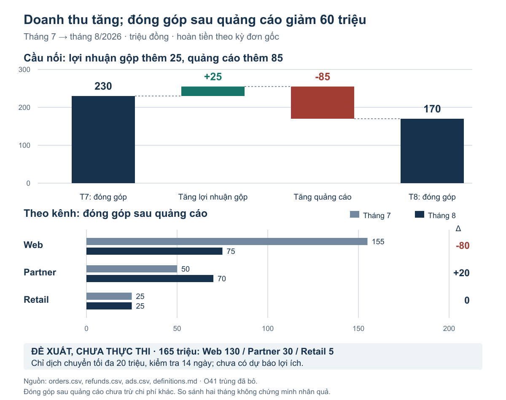
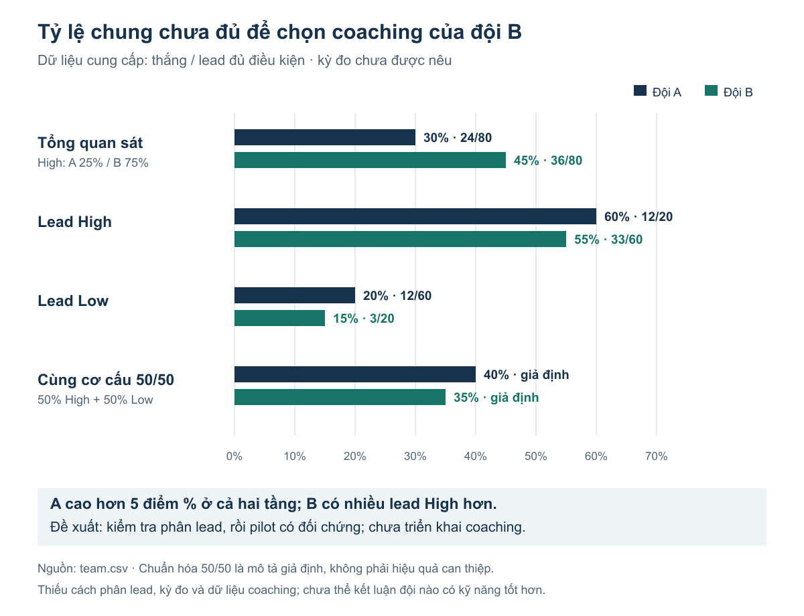

# Data Storytelling Skills

Six complementary Codex skills for turning evidence into useful business decisions and clear communication. English instructions support Vietnamese and English requests. This is an independently authored method suite, not an MDA or OpenAI product.

| Skill | Job |
|---|---|
| `data-storytelling` | Select and combine the work needed for a multi-output request |
| `business-insight-diagnosis` | Explain changes, prioritize findings and choose a supported action/test |
| `evidence-to-narrative` | Write a reader-ready memo, email draft or slide argument |
| `business-chart-communication` | Produce or repair an editable communication chart |
| `data-story-redteam` | Challenge and repair misleading claims, charts and recommendations |
| `analytics-adoption` | Plan recurring metric stewardship, decisions and outcome learning |

## Give a normal request

> Từ dữ liệu này, giải thích biến động, chọn việc nên làm, tạo biểu đồ và viết memo ngắn cho giám đốc. Kiểm lại số liệu và giữ rõ các giới hạn kết luận.

> Repair this chart and the conclusion it supports. Preserve the source data, show relevant denominators, and deliver an editable chart plus a concise explanation.

The assistant can select several complementary methods for one prompt. Direct invocation such as `$data-storytelling` or `$business-chart-communication` is also available. Descriptions and instructions support discovery; they are not an autonomous scheduler or a guarantee that every client will select correctly.

## Install

Copy the six folders under `skills/` into your client's discoverable skill directory (commonly `~/.codex/skills`). Each folder carries the references it needs. Automatic invocation is enabled.

Optional standard-library installer:

```text
python tools/install.py --dest ~/.codex/skills
python tools/install.py --dest ~/.codex/skills --apply --replace --backup-dir ./private-backups
```

The first command previews. Applying replacements requires a backup directory; existing resources not listed in this package are retained. No dependency download, server, credential or MCP setup is required. Use an available Python runtime appropriate to your machine. Refresh the client's skill metadata or start a fresh chat if its catalog is stale.

## Complement the existing stack

Use available statistical analysis for inference, economics for unit/capacity/scenario calculations, scientific visualization for figure mechanics, native Office/PDF methods for actual formats and verification methods for final numeric handoffs. Those methods are referenced, not bundled or required to be installed under a particular brand. The suite does not create tools, accounts, permissions or free API credits.

Canonical shared references live under `shared/`; `tools/sync_shared.py` copies them into the independently installable folders. Run `python tools/validate.py` after edits. Structural validation does not establish output quality.

## Source and evaluation

The suite operationalizes useful ideas from the user's 89-page MDA ebook using original wording and corrected scopes. [Method coverage](shared/source-method-map.md) records every source range and the treatment of advertising, unverified cases and rigid heuristics. The private original remains outside this repository. [Attribution](NOTICE.md) explains MIT's scope.

Evaluation uses synthetic inputs, normal-language requests, direct calculation checks, rendered artifacts and observed method selection. See `evals/README.md` for the protocol and recorded results. These pilots do not establish universal professional quality, causal business improvement or guaranteed routing. No production customer data or external commercial actions are used.

The 2026-10-12 pilot passed five subcases in both baseline and candidate conditions, plus two separate narrow controls. One compound prompt selected several complementary methods and delivered reconciled calculations, an editable chart and a Vietnamese decision memo. Baseline also passed; no superiority claim is made.

Example: [decision memo](evals/examples/candidate/A/memo-a.md), [editable SVG](evals/examples/candidate/A/chart-a.svg), [calculations](evals/examples/candidate/A/calculations-a.json).



Example repair: [team comparison note](evals/examples/candidate/B/note-b.md). Aggregate and within-tier comparisons are both shown; neither is described as a proven coaching effect.



## License

[MIT](LICENSE) for this project's original instructions, tools and synthetic examples. The source PDF and complementary third-party skills are not relicensed or redistributed.
