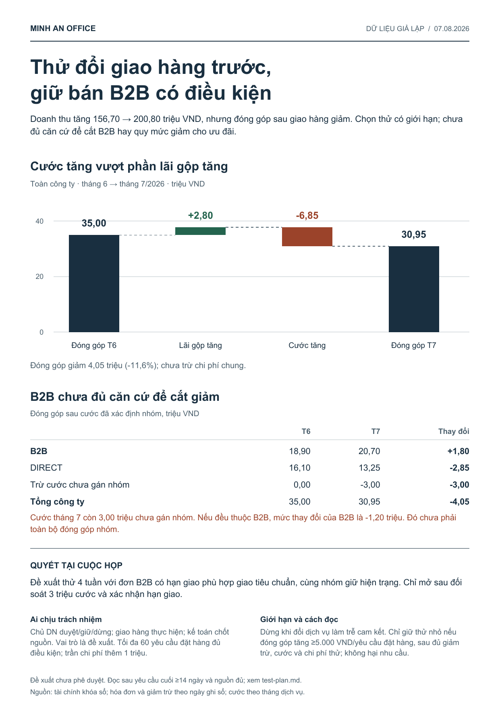

# Doanh thu tăng, đóng góp giảm: nên đổi gì?

[PDF một trang](brief.pdf) · [SVG sửa được](brief.svg) · [Bảng tính Excel](analysis.xlsx) · [Memo đầy đủ](memo.md)



Doanh thu tăng 44,10 triệu VND, nhưng đóng góp giảm 4,05 triệu. Cước tăng 6,85 triệu vượt phần lãi gộp tăng 2,80 triệu. Chi tiết cước còn thiếu 3 triệu nên chưa thể xác định đầy đủ kết quả từng nhóm.

**Hướng đề xuất:** giữ B2B trong phạm vi hiện tại và chuẩn bị thử giao tiêu chuẩn cho đơn có hạn giao phù hợp. Chỉ mở thử sau đối soát phần cước chưa gán nhóm và xác nhận cam kết/giá/người/ngân sách. Kế hoạch giữ nhóm hiện trạng, theo dõi mọi yêu cầu đã phân nhóm và tách ngày dừng nhận khỏi ngày đủ kết quả. Không coi chênh cước EXPRESS/STANDARD là khoản tiết kiệm chắc chắn.

## Giao yêu cầu

Copy [brief.md](brief.md) cùng năm file trong [inputs/](inputs/). Các source exports giữ nguyên bytes; tiền là VND nguyên, chưa VAT, credit theo tháng ghi sổ và cước theo tháng dịch vụ. Finance khóa sổ là tổng chính thức; overhead chưa trừ.

## Bàn giao vận hành

- [Kế hoạch thử bốn tuần](test-plan.md): điều kiện mở, đơn vị phân nhóm, capacity, giới hạn, metric, ngày đọc và quy tắc giữ/dừng.
- [Bản ghi đã điền](decision-record.csv): trạng thái đề xuất, phê duyệt, thực thi và kết quả tách riêng.
- [Phép tính và nguồn](analysis.json): totals, segment, độ phủ, sensitivity và SHA256.
- [Workbook](analysis.xlsx): bảng nguồn, tổng hợp, segment, giá và định nghĩa. Công thức có giá trị lưu sẵn được kiểm từ nguồn; chưa tính lại bằng Excel.

## Tái tạo

```text
python examples/01-profit-decision/rebuild.py --output ./scratch/profit-v3
```

Dependencies và giới hạn trong [gallery](../README.md). Script gắn với snapshot và từ chối nguồn đổi để tránh giữ lời kết luận cũ. Workbook có thể chỉnh sửa; nội dung memo phải được kiểm lại khi số liệu thay đổi.

Dữ liệu/tên giả lập. Bản này bắt đầu từ lượt thực thi độc lập dùng sáu skill 3.0, rồi được biên tập theo đọc trang và kiểm nguồn. Các giới hạn,60 yêu cầu, 1 triệu, 5.000 VND và lịch thử là đề xuất cần xác nhận, không phải chính sách hiện có, hiệu quả dự báo hoặc việc đã làm.
