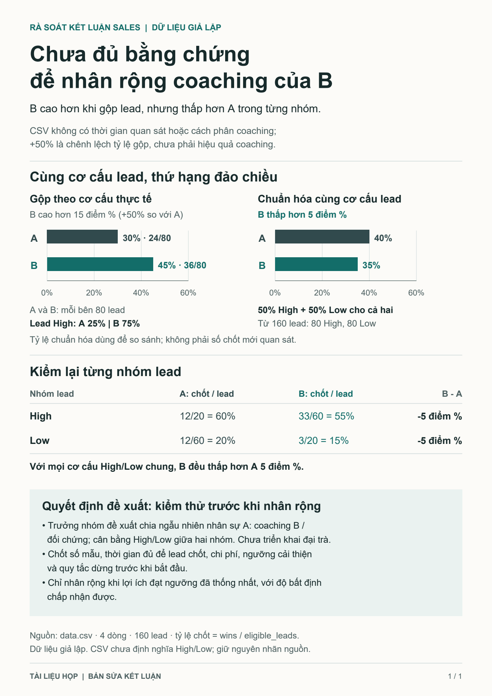

# “Up 50%” does not establish that coaching works

[One-page PDF](brief.pdf) · [Editable SVG](brief.svg) · [Corrected conclusion and memo](memo.md) · [Exact calculations](calculations.json)



## Example request

Supply [data.csv](data.csv) with this request:

> The sales report concludes: “B's coaching increased the win rate by 50%, so roll it out to A.” Check the conclusion against the CSV, correct the comparison, and identify the team lead's next decision. Create an attractive, clear, one-page document usable in a meeting without spoken explanation. Retain the correct numbers, show the comparison basis and evidence limits. No information about timing or coaching assignment is available beyond the CSV.

A: 24/80 = 30%; B: 36/80 = 45%. The 15 percentage-point difference equals 50% relative to A, but it is not a coaching effect. B has more High leads; within each tier, B is 5 points lower. The common 50/50 mix comes from 80 High and 80 Low leads out of 160: A is 40%, B is 35%. This is a descriptive comparison, not new win counts or a causal effect.

**Decision to prepare:** a controlled coaching trial, with the sample, window, thresholds, costs, and stopping rules agreed in advance. This data does not support a rollout yet. There is no evidence that A's coaching is better or B's is harmful; High/Low labels have not been defined.

## Rebuild

```text
python examples/02-fair-comparison/rebuild.py --output ./scratch/comparison-v3
```

[Dependencies and limits](../README.md). The script uses exact fractions, checks rates/denominators, and rejects changes to the four rows until the narrative has been reviewed.

This is a synthetic example. A fresh execution used version 3.0 redteam, chart, and narrative skills with the original input; the curated publication adds terminology edits and reframes the next decision after a reviewer read only the pixels. No trial has been executed, no customer outcome is shown, and no improvement over a baseline has been demonstrated. The original report and artifact files retain the Vietnamese requested for that run; they illustrate an example, not a language restriction. New work follows its intended audience and requested language, format, and domain.
