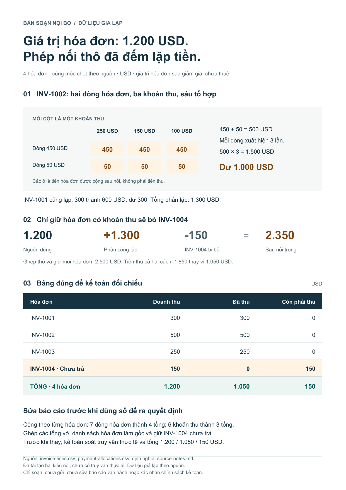

# Where does a join count money more than once?

[One-page PDF](brief.pdf) · [Editable SVG](brief.svg) · [Accounting CSV](invoice-reconciliation.csv) · [Memo](memo.md)



## Example request

Supply the two CSVs and the [source contract](inputs/source-notes.md):

> I joined invoice lines to payment allocations on invoice_id, and revenue jumped. Check the two CSVs, explain where the extra money comes from, and provide a reliable revenue-versus-cash-collected reconciliation for accounting, retaining unpaid invoices. Include a short, attractive, clear one-page explanation for internal sharing. Draft only; do not send it. The visual or table should make the specific error and correction visible.

The correct source totals in this example are USD 1,200 invoiced, 1,050 collected, and 150 outstanding. A raw join retaining every invoice reports 2,500; retaining only invoices with payments reports 2,350 and drops an unpaid invoice worth 150. Both also inflate collected cash to 1,850. The four invoices legitimately have multiple lines and/or payments; those records should not be deleted to fix the error.

**Correction:** aggregate each table separately by invoice, then join those totals using the invoice list as the base. Accounting should check the actual query and totals before replacing the report. The actual query type was not supplied, so the example reproduces both INNER and LEFT joins.

## Tools executed

The [audit report](audit/report.json) and [key-level evidence](audit/key-audit.csv) were created with the canonical helper. The many-to-many relationship is valid, but it does not make sums after the join valid. The script independently materializes both small joins to check row counts, repeated amounts, and omitted invoices. [Calculations](calculations.json) · [Check results](audit-result.json).

## Rebuild

```text
python examples/03-join-audit/rebuild.py --output ./scratch/join-v3
```

[Dependencies and limits](../README.md). To run only the independent standard-library audit:

```text
python skills/business-insight-diagnosis/scripts/join_audit.py --left examples/03-join-audit/inputs/invoice-lines.csv --right examples/03-join-audit/inputs/payment-allocations.csv --left-key invoice_id --right-key invoice_id --expect many-to-many --left-measure net_amount_usd --out ./scratch/join-audit
```

The data is synthetic, and no calendar date was supplied for the snapshot. This is a draft and reconciliation under the source contract; production has not been changed, and another organization's accounting policy has not been confirmed. A fresh independent run used version 3.0 diagnosis, composition, chart, and narrative skills; the curated publication includes language and handoff edits based on page reading. The original report and artifact files retain the Vietnamese requested for that run; they illustrate an example, not a language restriction. New work follows its intended audience and requested language, format, and domain.
