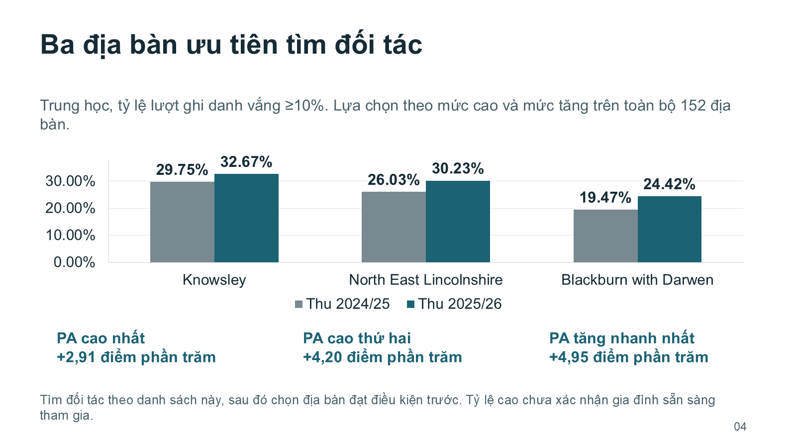
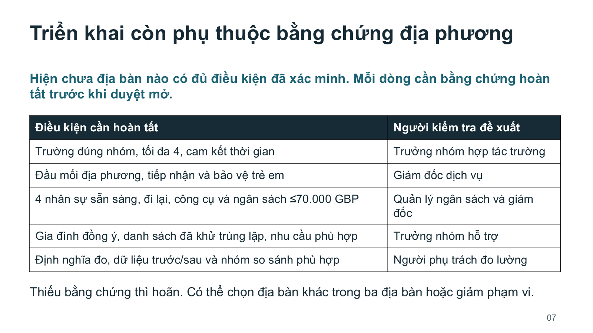

# 04 — Chuyên cần: tìm đối tác trước, chỉ mở khi đủ điều kiện

Một lượt chạy mới của skill **3.1.2** trên dữ liệu DfE thật, chưa dùng trong các lượt trước: toàn bộ 153 địa phương của England, hai nhóm trường và hai học kỳ thu. Agent nhận nguồn, brief trung lập và skill đã giữ cố định; không nhận hình cũ, đáp án hay danh sách địa phương mong muốn.

**PPTX, PDF, XLSX, mã dựng và README của recipe giữ nguyên byte từ lần bàn giao đầu tiên. Không sửa tay đầu ra sau đánh giá.** Hai lượt không đạt trước đó và các lỗi đã sửa trong skill được giữ trong [hồ sơ thử nghiệm](../../evals/forward-v3.1.md).



## Mở để dùng

| File | Công dụng |
|---|---|
| [PowerPoint](thu-nghiem-chuyen-can.pptx) | 9 trang; chữ, bảng và ba biểu đồ native để chỉnh sửa |
| [PDF](thu-nghiem-chuyen-can.pdf) | Xuất từ chính PowerPoint, dùng đọc hoặc họp |
| [Excel](tong-hop-chuyen-can.xlsx) | Tổng dùng trong slide, 304 so sánh và số đếm/công thức nguồn |
| [Brief gốc](rebuild/source/brief.vi.md) | Yêu cầu trung lập để tham khảo khi giao việc với dữ liệu của bạn |
| [Recipe nguyên bản](rebuild/README.md) | Runtime, cách dựng lại, giới hạn chỉnh sửa và cập nhật |

Dữ liệu là thật; ngân sách, công suất và dịch vụ là bối cảnh giả lập. Kết luận là tìm đối tác tại ba địa phương, chỉ đề xuất mở một nhóm tại nơi đủ điều kiện. Hiện chưa nơi nào được xác minh sẵn sàng. Chưa có chương trình được duyệt, triển khai hay hiệu quả được đo.



## Dựng lại

Sao chép cả `rebuild`, mở PowerShell 7.3+ tại đó và chạy vào thư mục đầu ra mới:

```powershell
pwsh -NoProfile -File ./Build.ps1 -SourceDir ./source -BuildDir ./build-06 -OutputDir ./generated-06
```

Cần Windows, PowerPoint/Excel desktop và runtime mô tả trong recipe. Recipe tìm runtime Codex của người chạy hoặc nhận đường dẫn cấu hình; không tải dependency hay đổi cấu hình toàn máy. Lệnh đã được chạy độc lập sau khi chuyển thư mục, với đúng các file được công bố: đủ 9 trang PDF khớp chữ/pixels và 8.684 ô Excel khớp giá trị, công thức và cache.

Biểu đồ chứa workbook snapshot, không tự nối với CSV/XLSX ngoài. Chỉnh sửa series native và đồng bộ bảng nhúng đã được kiểm; thao tác Edit Data thông thường và tự làm mới cache sau sửa ô qua COM chưa được xác nhận. Khi đổi nguồn, dùng đường dựng lại đã kiểm rồi xem lại số, nhãn, đề xuất và bản xuất. Kỳ mới hay bằng chứng xếp hạng đổi cần rà phương pháp/mã; bộ dựng khóa snapshot hiện tại.

## Đã kiểm và phần giữ nguyên

Năm nhóm kiểm tra đạt trong phạm vi đã đăng ký: nguồn/lập luận, định dạng native, trình bày, khả năng hiểu và bàn giao thực tế. Đối soát độc lập gồm 2.805 công thức, 8.684 ô tính lại bằng Excel, ba biểu đồ cùng dữ liệu nhúng, đủ chín trang và notes. Reviewer chỉ đọc ảnh và owner đều xem đủ trang; reviewer khác kiểm điều kiện hành động và cách dùng lại.

Vẫn giữ vài dòng xuống hàng ngắn, chữ PA và chênh lệch do làm tròn: mức thay đổi được tính từ số đầy đủ trước khi làm tròn. Đây là kiểm tra bằng model và file, chưa đo người đọc thật, thẩm mỹ được khách hàng chấp nhận, khả năng chiếu trong phòng họp hay tác động chương trình. Không có so sánh baseline trong lượt này.

Hai ảnh trên là bản xuất PowerPoint nguyên bản, không crop, vẽ lại hay chỉnh hình. [PUBLICATION.json](PUBLICATION.json) ghi hash của 14 file bàn giao/recipe/nguồn giữ nguyên và hai ảnh, kiểm tra cùng giới hạn.

## Phạm vi đóng gói

README trong `rebuild` là tài liệu nguyên bản của hồ sơ bàn giao. Tham chiếu lịch sử tới receipt riêng và `raw/methodology.html` không tồn tại trong bản công khai. Chúng được giữ riêng, không phải đầu vào tính toán. Bản công khai bỏ ba HTML website, receipt provenance/HTTP và năm receipt runtime có đường dẫn máy; giữ đủ raw CSV, cấu hình và mã cần dựng lại. Wrapper này và manifest là tài liệu công bố mới, không phải sửa nội dung đầu ra.

[Nguồn chính thức và giấy phép](SOURCES.md) thay cho các HTML riêng. MIT áp dụng phần nguyên gốc của dự án; thông tin DfE giữ Open Government Licence v3.0. Không có DfE bảo chứng.
