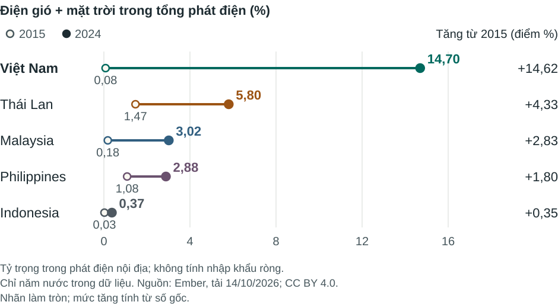
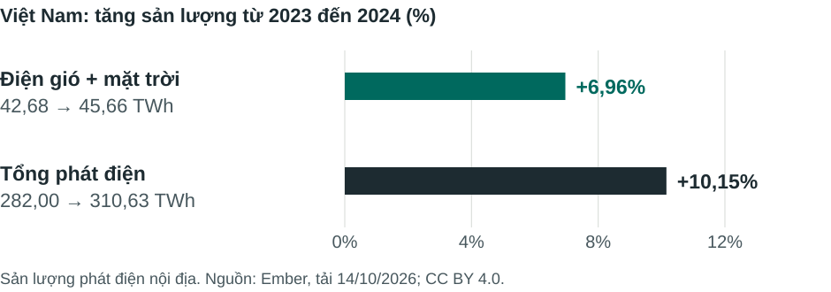

# Điện gió và mặt trời: khoảng cách mở rộng, tỷ trọng không tăng đều

Bản đọc bốn trang cho một cuộc họp biên tập giả lập, từ dữ liệu Ember thật của Việt Nam, Thái Lan, Malaysia, Philippines và Indonesia trong 2015–2024. Skill tự chọn góc bài, phép so sánh và bố cục; owner không xem nháp, sửa đầu ra hoặc sửa mã dựng sau lần bàn giao hoàn chỉnh.

[Tải HTML tự chứa rồi mở trong trình duyệt](https://github.com/builtbyhuy/data-storytelling-skills/raw/refs/heads/main/examples/05-asean-electricity/energy-editorial.vi.html) · [PDF bốn trang, chữ/vector](energy-editorial.vi.pdf) · [Sáu SVG chỉnh sửa được](charts/) · [Phép tính](calculations.vi.md) · [CSV 50 quan sát](annual-calculations.csv)

HTML reflow chữ và đổi bố cục biểu đồ trên điện thoại; nó không thu cả trang desktop thành một ảnh nhỏ. PNG trong `previews/` là bản phụ. Kích thước ảnh hoặc định dạng vector riêng lẻ không bảo đảm chữ đọc được ở mọi nơi hiển thị.





Đề xuất biên tập giữ cả bước tăng dài hạn lẫn ngoại lệ 2024: sản lượng vẫn tăng nhưng tỷ trọng giảm khi tổng phát điện tăng nhanh hơn. Dữ liệu không xác định nguyên nhân chính sách, giá hoặc chất lượng lưới điện. Trang cuối giao một phép đối chiếu trong hai ngày và cho biên tập viên điều kiện dùng kết quả, cùng phương án khi định nghĩa/phạm vi chưa khớp. Đây chưa phải bài báo được duyệt hay công việc thực tế đã giao.

## Dựng lại từ phần công khai

Giữ `source/` và `recipe/` cạnh nhau. Từ thư mục này, dùng PowerShell 7.3+ với runtime Codex và Chrome hiện có:

```powershell
& .\recipe\rebuild.ps1 -OutputDir (Join-Path $env:TEMP 'energy-editorial-rebuilt')
```

[Hướng dẫn recipe nguyên bản](README-rebuild.vi.md) có tham số cho Python launcher, Node, Playwright module và browser nếu ở vị trí khác, cùng các lệnh trực tiếp cho nền tảng khác. Không tự tải phụ thuộc. Bản public đã được sao chép sang thư mục khác và chạy đúng recipe này; HTML/SVG/tính toán trùng byte, cả bốn trang PDF tái tạo trùng chữ, kích thước và pixels.

Hướng dẫn nguyên bản mô tả gói lưu trữ đầy đủ hơn. PDF phương pháp Ember, ZIP gốc và các receipt kiểm tra riêng được giữ trong hồ sơ gốc; không phân phối ở đây. PDF phương pháp có [liên kết chính thức](https://files.ember-energy.org/public-downloads/ember_electricity_data_methodology.pdf) và hash trong [provenance](source/provenance.json). Nó không được code dựng lại đọc; phần public vẫn giữ CSV đóng băng, định nghĩa và toàn bộ recipe cần thiết. Các nhắc tới receipt gốc trong hướng dẫn không phải file có trong bản public.

## Phạm vi kiểm tra và nguồn

[PUBLICATION.json](PUBLICATION.json) ghi hash của 25 file gốc không đổi, phần wrapper được viết để đóng gói, kiểm tra và giới hạn. [Hồ sơ 3.2](../../evals/visual-v3.2.md) tách kiểm số, format, kích thước đọc, reader proxy và cách dựng lại. Không có đối chứng baseline mới hoặc đo thẩm mỹ/khả năng hiểu của người đọc thật.

Nguồn: [Ember Yearly Electricity Data](https://ember-energy.org/data/yearly-electricity-data/), CSV tải 14/10/2026, nguồn cập nhật 06/10/2026; giữ nguyên 200 dòng chọn theo ISO/năm/nguồn. Chỉ năm nước, không phải toàn ASEAN. Tỷ trọng lấy phát điện trong nước làm mẫu số và loại nhập khẩu ròng. `Wind and solar` chồng lặp các thành phần; không cộng tất cả các dòng với nhau.

Dữ liệu và thông tin nguồn Ember giữ [CC BY 4.0](https://ember-energy.org/creative-commons/); phân tích, code và trình bày riêng của dự án theo MIT. Không hàm ý Ember xác nhận hay bảo trợ. Đầu ra của ví dụ được publish để minh họa skill; trạng thái đề xuất biên tập bên trong tài liệu vẫn giữ nguyên.
